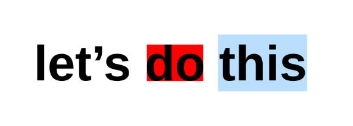
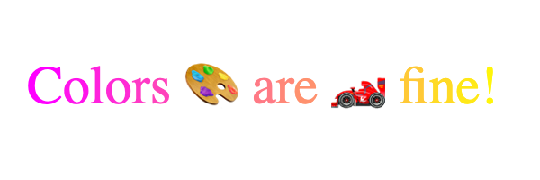
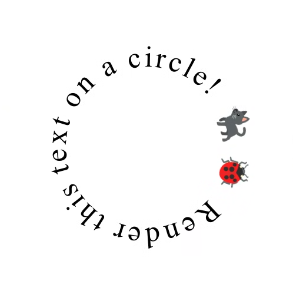

# Enhanced TextMetrics

**Status**: explainer.

## Goals

Extend the capabilities of Canvas 2D text (`CanvasText`) to support text shaping inspection, selection rectangles, bounding box queries over character ranges, hit testing, caret positioning, and isolated glyph run/cluster rendering.

## Rationale

Users should be able to interact with canvas-based text input that correctly renders selection and caret positions.

All metrics available through DOM APIs should also be available when shaping text on Canvas. Furthermore, single-style shaping via `shapeText()` does not require full DOM layout, while providing a natural foundation for future multi-style extensions.

We also want to provide more power to current canvas text rendering APIs by exposing shaped `GlyphRun`s and minimal glyph clusters while keeping `TextMetrics` focused on measurement geometry.

## Proposal

```webidl
[Exposed=(Window,Worker)]
interface GlyphRun {
  readonly attribute unsigned long start;
  readonly attribute unsigned long end;
  readonly attribute double x;
  readonly attribute double y;
  readonly attribute double width;

  TextMetrics textMetrics();
};

[Exposed=(Window,Worker)]
interface ShapedText {
  readonly attribute double width;

  sequence<GlyphRun> glyphRuns();
  sequence<GlyphRun> glyphClusters();
  sequence<GlyphRun> glyphClusters([EnforceRange] unsigned long start, [EnforceRange] unsigned long end);

  sequence<DOMRectReadOnly> selectionRects([EnforceRange] unsigned long start, [EnforceRange] unsigned long end);
  DOMRectReadOnly actualBoundingBox([EnforceRange] unsigned long start, [EnforceRange] unsigned long end);
  unsigned long advanceToPosition(double advance);
  double positionToAdvance([EnforceRange] unsigned long position);
};

partial interface mixin CanvasText {
  // Included by CanvasRenderingContext2D and OffscreenCanvasRenderingContext2D.

  ShapedText shapeText(DOMString text);

  undefined fillGlyphRun(GlyphRun run, double x, double y);
  undefined strokeGlyphRun(GlyphRun run, double x, double y);
  undefined fillGlyphRuns(sequence<GlyphRun> runs, double x, double y);
  undefined strokeGlyphRuns(sequence<GlyphRun> runs, double x, double y);
};
```

`shapeText()` shapes the input string using the current `CanvasTextDrawingStyles` on the context (`font`, `textAlign`, `textBaseline`, `direction`, `letterSpacing`, `wordSpacing`, `fontKerning`, `fontStretch`, `fontVariantCaps`, `textRendering`, `lang`) and returns an immutable `ShapedText` object. All coordinates on `ShapedText` and its `GlyphRun`s are relative to the text's aligned anchor point `(0, 0)` (taking `textAlign` and `textBaseline` at `shapeText()` time into account).

`selectionRects()` returns the set of rectangles that the UA would render as selection to select a particular character range `[start, end)` (in UTF-16 code units).

`actualBoundingBox()` returns an equivalent box to `TextMetrics.actualBoundingBox*`, i.e., the ink bounding rectangle for the drawing of that `[start, end)` range. Notice that this can be (and usually is) different from the selection rect, as those are about the flow and advance of the text. A font that is particularly slanted or whose accents go beyond the flow of text will have a different paint bounding box. For example: if you select this: ***W*** you will see that the end of the W is outside the selection area, which would be covered by the paint (actual bounding box) area.

The `advanceToPosition()` method (formerly `getIndexFromOffset()` / `caretPositionFromPoint()`) returns the code unit index for the character at the given `advance` distance from the anchor position of the shaped text (accounting for `textAlign`) with `advance` always increasing left to right (so negative values are valid). Values to the left or right of the text bounds will return `0` or `text.length` depending on the writing direction. The functionality is similar but not identical to [`document.caretPositionFromPoint`](https://developer.mozilla.org/en-US/docs/Web/API/Document/caretPositionFromPoint). In particular, there is no need to return the element containing the caret and offsets beyond the boundaries of the string are acceptable.

Conversely, `positionToAdvance()` returns the horizontal caret offset (relative to the `ShapedText` anchor point) corresponding to the given UTF-16 code unit `position`.

`glyphRuns()` returns the shaped directional and font-resolved `GlyphRun`s in visual order.

`glyphClusters()` breaks the shaped text down into minimal shaped glyph clusters (returned as `GlyphRun` objects) for the given `[start, end)` character range (or the entire string if no range is passed). Each `GlyphRun` exposes its `[start, end)` UTF-16 code unit range in the input string, its `(x, y)` offset relative to the `ShapedText` anchor point, its advance `width`, and `textMetrics()` (which returns the `TextMetrics` for that run and its resolved font).

To render runs or clusters onto the canvas, `fillGlyphRun()`, `strokeGlyphRun()`, `fillGlyphRuns()`, and `strokeGlyphRuns()` are proposed on the rendering context. Each `GlyphRun` is rendered at `(x + run.x, y + run.y)`, using the font and `CanvasTextDrawingStyles` captured when `ctx.shapeText()` was called, regardless of subsequent changes to those properties on the context. Because shaping is performed over the full string in `shapeText()`, rendering individual clusters via `fillGlyphRun()` or `fillGlyphRuns()` preserves contextual shaping, ligatures, and kerning.

`selectionRects()`, `actualBoundingBox()`, and `glyphClusters()` operate on UTF-16 code unit ranges and use positions relative to the shaped text's origin (i.e., `textBaseline`/`textAlign` is taken into account).

## Example usage

```js
const canvas = document.querySelector('canvas');
const ctx = canvas.getContext("2d");

ctx.font = '60px sans-serif';
ctx.textAlign = 'center';
ctx.textBaseline = 'middle';
ctx.translate(canvas.width / 2, canvas.height / 2);

const shapedText = ctx.shapeText("let's do this");
ctx.fillStyle = 'red';
const boxForSecondWord = shapedText.actualBoundingBox(6, 8);
ctx.fillRect(
    boxForSecondWord.x,
    boxForSecondWord.y,
    boxForSecondWord.width,
    boxForSecondWord.height,
);
const selectionForThirdWord = shapedText.selectionRects(9, 13);
ctx.fillStyle = 'lightblue';
for (const s of selectionForThirdWord) {
    ctx.fillRect(s.x, s.y, s.width, s.height);
}
ctx.fillStyle = 'black';
ctx.fillGlyphRuns(shapedText.glyphRuns(), 0, 0);
```

Expected output:



```js
const canvas = document.getElementById('canvas');
const ctx = canvas.getContext('2d');

ctx.font = '60px serif';
ctx.textAlign = 'center';
ctx.textBaseline = 'middle';

const text = 'Colors 🎨 are 🏎️ fine!';
const shapedText = ctx.shapeText(text);
const clusters = shapedText.glyphClusters();

const colors = ['orange', 'navy', 'teal', 'crimson'];
for (const cluster of clusters) {
    ctx.fillStyle = colors[cluster.start % colors.length];
    ctx.fillGlyphRun(cluster, canvas.width / 2, canvas.height / 2);
}
```

Expected output:



```js
const canvas = document.getElementById("canvas");
const ctx = canvas.getContext('2d');

const center_x = 250;
const center_y = 250;
const radius = 150;
ctx.font = '50px serif';
ctx.textAlign = 'left';
ctx.textBaseline = 'middle';
const text = "🐞 Render this text on a circle! 🐈‍⬛";

const shapedText = ctx.shapeText(text);
const clusters = shapedText.glyphClusters();

for (const cluster of clusters) {
    // Since ctx.textAlign was set to 'left' before shaping, all values of
    // cluster.x are non-negative. Use the horizontal midpoint of each cluster.
    const clusterCenter = cluster.x + cluster.width / 2;
    const p = clusterCenter / shapedText.width;
    const rad = 2 * Math.PI * p;
    const x = radius * Math.cos(rad) + center_x;
    const y = radius * Math.sin(rad) + center_y;
    ctx.save();
    ctx.translate(x, y);
    ctx.rotate(rad + Math.PI / 2);
    ctx.translate(-x, -y);
    // Offset by -clusterCenter and -cluster.y so the cluster is centered at (x, y).
    ctx.fillGlyphRun(cluster, x - clusterCenter, y - cluster.y);
    ctx.restore();
}
```

Expected output:



## Alternatives considered
### DOM Element inputs
Instead of a plain string, the `shapeText()` API could take an `Element` wrapper.

#### Pros
* Access to full CSS styling capabilities for text, beyond what is currently available in Canvas.
* Potentially improved accessibility.

#### Cons
##### High-level considerations
Sophisticated clients (e.g. FlutterWeb or Google Docs), which stand to benefit most from this proposal, already implement bespoke a11y solutions in higher layers.  Enforcing a11y at this level is unnecessary in their case, and would result in unneeded friction.

More generally, a11y at this level runs into a couple of issues:

1) **Scoping/granularity**: `shapeText()` is a low-level utility that doesn’t necessarily receive a full semantic payload in a single call.  Clients may decide to break down the input text for rendering in various ways (e.g. small view into a larger paragraph, streaming text, etc), and they may not even shape or measure the fragments in a semantically-meaningful order.

2) **Shaping-vs-presentation sequencing**: a `shapeText()` call does not render any text by itself, and activating the a11y machinery at that stage seems fragile.  The client may decide to defer rendering, to only render parts of the string, or to not render at all (shaping/measuring for other purposes).

##### API ergonomics
`ShapedText.glyphClusters()` returns input-domain indices, in order to surface character-cluster -> glyph-cluster mapping information to clients.  If the input string is to be presented as a DOM element, the semantics become more convoluted - how do we convey indexing information for element-wrapped text?  One possible solution is to return [`CaretPositions`](https://developer.mozilla.org/en-US/docs/Web/API/CaretPosition), which would potentially allow reconstructing the indices in the character domain.  Since clients start with a string, these additional transformations introduce friction and create opportunities for errors.

The current proposal is also incremental, meant to minimize the affected API surface area and align with standard Canvas 2D string-based text entry points (`fillText()`, `strokeText()`, `measureText()`).  Changing the input to an element would require more extensive API updates.

##### Performance concerns
* Overhead for shaping/measuring text presented as an Element: unlike the low level version of the proposal, the high-level/Element version activates additional implementation layers which add up to non-trivial overhead (CSS resolution, layout).

* Overhead for allocating/managing DOM elements.

### HTML-in-Canvas

Use [HTML-in-Canvas](https://github.com/WICG/html-in-canvas) (formerly known as `placeElement`/`drawElement`) as a general solution for sophisticated text rendering in Canvas.

#### Pros
Potentially more accessible, full CSS capabilities.

#### Cons
While there is some overlap, HTML-in-Canvas does not address some of the core/complex text shaping use cases supported by `ShapedText`/`GlyphRun`.  Specifically, the ability to draw clusters in isolation, with different transforms/positioning than originally measured.

HTML-in-Canvas is also in the proposal stages, and the availability/timeline is unclear.

The same performance concerns apply.

### WebKit proposal

This proposal shares its core architecture with WebKit's [CanvasTextShaping proposal](https://github.com/WebKit/explainers/pull/137): separating text shaping (`shapeText()`) from measurement (`measureText()`), representing both shaped runs and minimal clusters with a unified `GlyphRun` type, exposing per-run font metrics via `GlyphRun.textMetrics()`, and rendering via `fillGlyphRun(s)` / `strokeGlyphRun(s)`.

Where this proposal diverges from WebKit's initial sketch, it does so for API ergonomics, performance, and incremental standardization:

#### 1. `ShapedText` wrapper vs. returning a raw `sequence<GlyphRun>`
In the WebKit sketch, `ctx.shapeText()` returns a raw `sequence<GlyphRun>`, and hit-testing/splitting methods (`advanceToPosition()`, `positionToAdvance()`, `split()`) live on `GlyphRun`. Returning a `ShapedText` container instead provides several benefits:

* **Shared shaping state**: All `GlyphRun`s produced from a `shapeText()` call share the same underlying shaped text buffer, font, and context styles. Retaining that state once on `ShapedText` reduces per-run/per-cluster memory overhead.
* **String-level query surface**: Selection rectangles (`selectionRects()`), ink bounds (`actualBoundingBox()`), hit testing (`advanceToPosition()`), and caret positioning (`positionToAdvance()`) naturally operate across the entire shaped string—including across bidi and fallback-font run boundaries—without forcing callers to manually iterate and stitch results across individual `GlyphRun`s.
* **Unambiguous string-global indexing**: Hosting `glyphClusters(start, end)` and range queries on `ShapedText` keeps all character offsets in a single, consistent `[0, text.length]` coordinate space relative to the input string, avoiding ambiguity between string-global and run-local indices when slicing a `GlyphRun`.

#### 2. Direct `GlyphRun` geometry (`start`, `end`, `x`, `y`, `width`) vs. nested `TextRun`
In the WebKit sketch, a `GlyphRun` nests its source range inside a `TextRun` object (`{ text, start }`) and only exposes its advance via `run.textMetrics().width`.

* **`[start, end)` indices instead of a `text` substring**: Callers already hold the input string passed to `shapeText(text)`. Exposing `start` and `end` (UTF-16 code unit offsets) directly on `GlyphRun` is self-documenting, avoids allocating a `TextRun` wrapper and substring copy per cluster, and eliminates the boilerplate of computing `start + text.length`.
* **Direct `(x, y)` position and `width` advance**: Exposing `x`, `y` (relative to the `ShapedText` anchor point), and `width` directly on `GlyphRun` allows clients to position, transform, or animate clusters in arbitrary order (e.g. text on a path) without maintaining a manual advance accumulator or allocating a `TextMetrics` object for every cluster in hot loops.

#### 3. Phased scoping: `FormattedText` and `Intl.Segmenter`
WebKit's explainer also includes multi-style inputs (`FormattedText` / `FormattedTextRun`) and a static `Intl.Segmenter.breakText()` method for line-break opportunities. Those parts are intentionally decoupled from this initial proposal:

* **Single-style `shapeText(DOMString)` first**: Existing canvas text engines (such as Flutter Web) already manage style spans and line breaking, and only require single-style shaping and cluster rendering from Canvas 2D. Starting with `shapeText(DOMString)` matches `fillText()` / `strokeText()` / `measureText()` and remains forward-compatible with a future `shapeText(FormattedText)` overload.
* **Extending `Intl.Segmenter` in ECMA-402**: Line-break segmentation is standardized in ECMA-402 (TC39) rather than HTML. Extending the existing `Intl.Segmenter` instance API (which already supports `'grapheme'`, `'word'`, and `'sentence'` granularities and respects instance locale options) with `{ granularity: 'line' }` is a cleaner fit than a static `Intl.Segmenter.breakText()` method, and decoupling it avoids blocking Canvas 2D text shaping on a cross-committee dependency.
